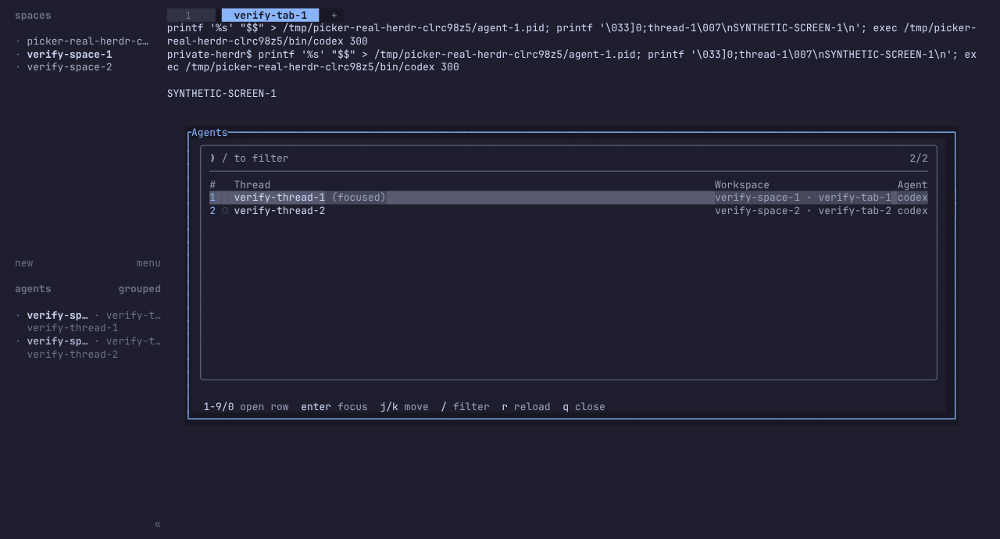

# agents-picker

A full-width thread picker for Herdr, forked from
[yxhta/herdr-agents-picker](https://github.com/yxhta/herdr-agents-picker).
Thread names get most of the space. Rows show a number, agent status, thread,
workspace/tab and agent type. Herdr supplies the outer popup border and single
`Agents` title. A rounded inner panel groups search and threads, with keyboard
hints below. There is no terminal preview.



The popup uses 95% width and 60% height, stored in the plugin manifest. If opened
from an agent session, that agent starts selected.

## Install

```sh
herdr plugin install aryan-binazir/herdr-agents-picker --ref <reviewed-commit>
```

Replace `<reviewed-commit>` with the deployed commit recorded in your dotfiles
Herdr `AGENTS.md`. Install on each machine. The plugin ID stays
`yxhta.agents-picker`, so existing keybindings work. Inspect `herdr plugin list`
before replacing an existing installation; preserve any local modifications.
GitHub installs replace in place with rollback on failure. For a local link,
run `herdr plugin unlink yxhta.agents-picker` before the pinned install.

Requires Herdr 0.7.2+ on macOS or Linux. The install step builds the plugin
from source (`cargo build --release --locked`), so a Rust toolchain is needed.

## Keys

Modal, matching the built-in workspace picker: navigate by default, `/` for
incremental search. `enter` focuses the selected agent and `ctrl+c` closes in
both modes.

Navigate mode:

| Key         | Action                    |
| ----------- | ------------------------- |
| `1`–`9`, `0` | open the correspondingly numbered visible row |
| `j` / `k`   | move selection            |
| `↑` / `↓`   | move selection            |
| `/`         | enter incremental search  |
| `r`         | reload the agent list now |
| `q` / `esc` | close without focusing    |

Search mode:

| Key                 | Action                            |
| ------------------- | --------------------------------- |
| type                | fuzzy-filter agents incrementally |
| `esc`               | cancel search (clears the filter) |
| `↑` / `↓`           | move selection                    |
| `ctrl+k` / `ctrl+j` | move selection                    |
| `ctrl+p` / `ctrl+n` | move selection                    |
| `ctrl+r`            | reload the agent list now         |
| `ctrl+u`            | clear the filter                  |
| `ctrl+w`            | delete the last word              |

The first ten visible rows are numbered `1` through `9`, then `0`. Scrolling
and refreshes update those labels. Press a digit to open its current row;
unavailable digits do nothing. During search, digits are ordinary query text
and shortcut labels are hidden. Enter opens the selected agent in either mode.

The agent list refreshes every 2s. The selected agent stays selected across
refreshes and reordering. Spinners redraw every 100ms.

The default list order mirrors Herdr's built-in Agents sidebar and follows
`ui.agent_panel_sort`: `spaces` keeps workspace/tab/pane grouping, while
`priority` orders agents by attention (`blocked`, `done`, `working`, `idle`,
then `unknown`). Within the same state, the plugin records Herdr status-change
events and shows the most recently changed agent first. Configuration changes
are picked up on the next list refresh.

## UI

The status column mirrors Herdr's built-in Agents sidebar: braille spinner
(yellow) = working, `◉` (red) = blocked, `●` (teal) = done, `✓` (green) = idle,
and `○` (dim) = unknown. While searching, fuzzy-matched characters are
highlighted in the list. Explicit names replace automatic titles and are kept
verbatim. Otherwise, the picker uses the session title with known agent prefixes
such as `π -` removed. Missing titles and agent-only titles show `Untitled thread`.
Search still includes the working directory even though it is not displayed,
so directory-only matches have no visible highlight.

Agent statuses depend on Herdr's integrations. Machine setup, including Pi's
stock integration, belongs in the dotfiles Herdr `AGENTS.md`.

## Setup (local checkout)

For development, link a local checkout instead of installing. Build first:

```sh
cargo build --release
```

If you use [mise](https://mise.jdx.dev/), `mise install` provides the Rust
toolchain declared in `mise.toml`.

Link only a permanent checkout, after building it:

```sh
herdr plugin link "$PWD"
```

Keybinding in herdr's `config.toml` (`prefix+a`):

```toml
[[keys.command]]
key = "prefix+a"
type = "plugin_action"
command = "yxhta.agents-picker.open"
description = "agents picker"
```

Manual open without the keybinding:

```sh
herdr plugin pane open --plugin yxhta.agents-picker --entrypoint picker
```

## How it works

- `herdr-plugin.toml` declares a `popup` pane (`picker`) running the TUI and an
  action (`open`) that opens that pane, so a `plugin_action` keybinding works.
- The TUI uses `HERDR_BIN_PATH`: `agent list` for rows and `workspace list` /
  `tab list` for locations. On selection, it restores the terminal and focuses
  workspace, tab, then agent. `pane_id` is the preferred target; `terminal_id`
  remains a fallback for older payloads.
- The workspace/tab label mirrors the built-in sidebar's default agent row:
  workspace name, plus the tab name only when the workspace has more than one
  tab or the tab was given a custom (non-numeric) name.

## Development

```sh
cargo test --all-targets --all-features --locked
cargo clippy --all-targets --all-features --locked -- -D warnings
cargo fmt --all -- --check
```

Measure drawing and filtering with a 160×32 in-memory terminal:

```sh
cargo run --release --locked --example interaction
```

The benchmark prints microseconds per iteration for 20, 200, and 2,000
synthetic agents. `draw` measures a full frame; `search_draw` also applies
the filter and computes rankings and highlights. Both validate the result.
Herdr CLI calls and terminal I/O are outside the timed region.
Set `PICKER_BENCH_ITERATIONS` to change the default 100 iterations, or
`PICKER_BENCH_AGENTS` to use a single positive agent count. Compare release
binaries in alternating order over at least five runs. Report the median
and range. `--snapshot` prints screens and selection states for scrolling,
resizing, and filtering comparisons.

The `[[build]]` command in the manifest only runs on `herdr plugin install`
from GitHub; linked checkouts build manually as above.

## License

[MIT](LICENSE)
